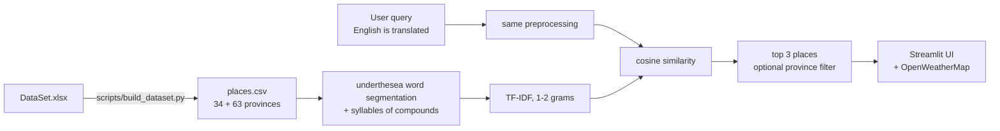

# Vietnam Travel Recommendation System

[](https://github.com/HongTin2104/VietNam-Travel-Recommendation-System/actions/workflows/ci.yml)
[](https://vietnam-travel-recsys.streamlit.app/)
[](https://github.com/HongTin2104/VietNam-Travel-Recommendation-System/releases)
[](pyproject.toml)
[](LICENSE)
[](data/DATASET.md)

Describe the trip you want in Vietnamese or English and get matching destinations from a hand-built dataset of
315 places, organised by the 34 provinces in effect since July 2025.

**Try it online: [vietnam-travel-recsys.streamlit.app](https://vietnam-travel-recsys.streamlit.app/)** (no install
needed; the app may take a few seconds to wake up if nobody has used it recently).


## Why

Most travel lists are organised by province, but people search by what they want to do: a quiet beach, a historic
site, a cool mountain town. This app matches a free-text description against short descriptions of places across
the whole country, and it already uses the province names after the 1 July 2025 merger (63 to 34 units), while
still showing the old province for each place.

## Data

| | |
|---|---|
| Places | 315, five for each of the 63 pre-2025 provinces |
| Provinces | mapped to the 34 units of July 2025 (Resolution 202/2025/QH15) |
| Fields | name, new and old province, description, rating, keywords, image URL |
| Collected | 2024, compiled by hand |
| License | CC BY 4.0 for the text data |

The cleaned table is [`data/processed/places.csv`](data/processed/places.csv). Sources, processing steps and
known issues are in the [dataset card](data/DATASET.md).

## How it works



Descriptions are lowercased, stripped of punctuation and numbers, and segmented into words with
[underthesea](https://github.com/undertheseanlp/underthesea). Segmentation joins "bãi biển" into a single token,
which means a query for "biển" no longer matches it, so the syllables of every compound word are kept next to the
segmented words. TF-IDF over unigrams and bigrams is then compared to the query with cosine similarity.

TF-IDF was kept over embedding models because the descriptions are short and the whole model fits in memory with
no download, which keeps the app easy to run and to read.

## Results

There are no human relevance judgements yet, so the evaluation uses the dataset's own keyword tags as labels: each
tag shared by 3 to 30 places is a query, and the places carrying it are the correct answers (46 queries over the 215
tagged places). Reproduce with `python scripts/evaluate.py`.

| Model | P@3 | R@10 | MRR |
|---|---|---|---|
| Random (200 shuffles) | 0.036 | 0.049 | 0.123 |
| Highest rating first | 0.022 | 0.043 | 0.089 |
| TF-IDF, syllables (no word segmentation) | 0.196 | 0.349 | 0.342 |
| TF-IDF, syllable 1-2 grams | 0.188 | 0.347 | 0.352 |
| TF-IDF, underthesea words | 0.181 | 0.292 | 0.348 |
| **TF-IDF, words + syllables, 1-2 grams (app)** | **0.217** | **0.350** | **0.373** |

Word segmentation alone does worse than plain syllables on recall. Adding the syllables back gives the best score
on all three metrics, though with 46 queries the gaps between the TF-IDF variants are small.

## Run it

Requires Python 3.11+.

```bash
git clone https://github.com/HongTin2104/VietNam-Travel-Recommendation-System.git
cd VietNam-Travel-Recommendation-System
pip install -r requirements.txt
streamlit run main.py
```

Open http://localhost:8501.

Weather is optional. Get a free key from [OpenWeatherMap](https://home.openweathermap.org/api_keys), copy
`.env.example` to `.env` and set `OPENWEATHER_API_KEY`. Never commit `.env`.

With Docker:

```bash
docker build -t vietnam-travel .
docker run --env-file .env -p 8501:8501 vietnam-travel
```

Tests and lint:

```bash
pip install pytest pytest-cov ruff
ruff check . && pytest --cov
```

See [CONTRIBUTING.md](CONTRIBUTING.md) before opening a pull request.

## Project structure

```
├── main.py                  # Streamlit app
├── data_processing.py       # preprocessing and TF-IDF features
├── recommendation.py        # ranking and province filter
├── weather.py               # OpenWeatherMap (optional)
├── translation.py           # English to Vietnamese query translation
├── data/
│   ├── DataSet.xlsx         # original hand-compiled sheet
│   ├── short_links.csv      # resolved surl.li image links
│   ├── processed/places.csv # cleaned data used by the app
│   └── DATASET.md           # dataset card
├── scripts/
│   ├── province_mapping.py  # 63 -> 34 provinces
│   ├── build_dataset.py     # DataSet.xlsx -> places.csv
│   ├── resolve_short_links.py
│   ├── check_image_links.py
│   └── evaluate.py          # writes reports/evaluation.md
├── reports/evaluation.md
└── tests/
```

## Limitations

- 315 places, five per old province, is a sample rather than a complete guide.
- The evaluation labels are the dataset's own keyword tags, which often reuse words from the descriptions, so they
  favour word overlap. Human relevance judgements would give a fairer number.
- Descriptions are short (median 148 characters), so the model cannot tell apart places described in similar
  words.
- English queries go through a free translation service and fail when it is unavailable; the app then searches
  with the original text.
- About a fifth of the images are hotlinked from third-party sites that have since removed them.
- Two rows look mislabelled (see [Known issues](data/DATASET.md#known-issues)).

Ideas for later: more places per province, sentence embeddings (PhoBERT, multilingual-e5) compared against the
same evaluation, and filters for region or season.

## Dành cho sinh viên

Repo này phù hợp làm tài liệu tham khảo cho đồ án môn Khai phá dữ liệu, Xử lý ngôn ngữ tự nhiên hoặc Hệ gợi ý.
Dùng thử ngay trên trình duyệt: https://vietnam-travel-recsys.streamlit.app/
Bài viết giải thích chi tiết (Viblo):
[Gợi ý du lịch Việt Nam bằng TF-IDF và underthesea](https://viblo.asia/p/goi-y-du-lich-viet-nam-bang-tf-idf-va-underthesea-viblo-8X4EjW52JN2)

- **Dữ liệu tự thu thập:** 315 địa điểm của 63 tỉnh cũ, đã ánh xạ sang 34 tỉnh, thành mới từ 1/7/2025
  ([`scripts/province_mapping.py`](scripts/province_mapping.py)). Có thể dùng lại bảng ánh xạ này cho dự án khác.
- **Xử lý tiếng Việt:** tách từ bằng underthesea. Kết quả đánh giá cho thấy chỉ tách từ thì truy vấn một âm tiết
  như "biển" không khớp với "bãi_biển", nên mô hình giữ thêm các âm tiết của từ ghép.
- **Có đánh giá định lượng:** so sánh với baseline ngẫu nhiên và các biến thể TF-IDF (P@3, R@10, MRR), chạy lại
  được bằng `python scripts/evaluate.py`.
- **Hướng mở rộng cho đồ án:** thêm địa điểm, dùng embedding (PhoBERT) rồi so với bảng kết quả ở trên, gắn nhãn
  liên quan bằng tay cho một bộ câu hỏi, gợi ý theo mùa hoặc theo vùng miền.

Nếu dùng dữ liệu hoặc code, hãy ghi nguồn repo này.

## Citation

```bibtex
@misc{vietnam_travel_recsys,
  author = {HongTin2104},
  title  = {Vietnam Travel Recommendation System},
  year   = {2024},
  url    = {https://github.com/HongTin2104/VietNam-Travel-Recommendation-System}
}
```

## License

Code: [MIT](LICENSE). Data: [CC BY 4.0](https://creativecommons.org/licenses/by/4.0/), see the
[dataset card](data/DATASET.md).
